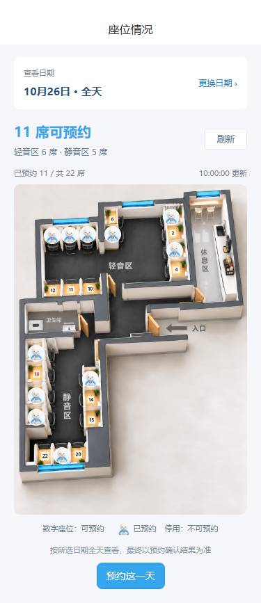

# 全屏加载与首页热门活动预览

打开 `2026-10-25-home-activities.html` 查看评审时保存的交互预览。该预览保留模拟加载按钮；同款活动卡片及翻书动画现已接入小程序源码。

- 活动内容来自当前公开活动列表：2 元/人的参观券、799 元/人的双人同行上岸卡；标题、副标题、标签、原配图与原价均按现有内容展示。
- 将详情入口移入活动卡片，说明自然换行；价格单位整理为 `/人`，避免与金额重复。
- 打开时自动演示全屏翻书；“看翻书加载”可重播慢加载，“模拟快速加载”保留 400 毫秒过渡，“直接看活动”可立即结束演示。
- 原配图通过现有公开 URL 加载，离线或加载失败时展示文字兜底。本预览不调用购买、登录、预约或后台修改接口。
- 小程序使用全屏加载画面：浅色实底、居中翻书与答岸标识，覆盖导航、页面内容和自绘底栏。首页首次统一等待轮播、活动、门店数据；预约选座和当前座位页首次读取时也整屏展示。
- 全屏立即出现，短请求保留约 400 毫秒的过渡以避免闪屏，数据就绪后退出；后台刷新保留已显示内容，不遮屏。首页请求超时或失败也会解除加载层，最长等待 12 秒。
- 配图失败时显示文字兜底，活动入口保持后台配置；空活动列表隐藏整块，座位加载失败可重试。切页或组件销毁时清理动画等待计时器。
- 未改动其他首页模块，也未上传或发布小程序。

验证：320 / 375 / 430 像素宽度的源码组件均覆盖整个视口，加载期间阻止底层点击，退出后恢复操作；快速加载保留短暂过渡，慢加载完成后立即退出，切页和销毁时清理计时器，无脚本错误。

源码接入验证：`node tests/fullscreen-loading.test.cjs` 覆盖最短显示时间、重复加载、生命周期清理、首页三请求聚合、请求失败与超时放行、离页后不回写加载状态，以及异常门店缓存恢复。活动与预约入口保留原有逻辑，当前座位后台刷新保留已显示内容。

微信组件打包修正：加载动画与占座吉祥物通过 easycom 生成独立的微信原生组件注册，避免只生成 `Component({})` 空壳。构建后执行 `node tests/verify-wechat-components.cjs` 检查组件注册、样式及三个页面的引用。

座位查阅按日期统一：主页显示今日全天余座；座位情况页只提供日期选择（今天至未来 30 天），按当天 00:00 至次日 00:00 查询。切换日期立即清除旧图并忽略旧请求，后台同日刷新保留当前图。“预约这一天”会把日期一次性带入原有预约页，沿用价格、卡券和最终锁座校验。预约页返回时刷新日期范围，避免跨午夜继续选过去日期。

日期流程验证：`node tests/date-only-seats.test.cjs` 覆盖日期边界、北京时间换日、全天查询参数、切日竞态、日期传递、门店匹配和跨午夜返回。下图用真实座位页源码与本地图片渲染，座位状态使用测试数据。

